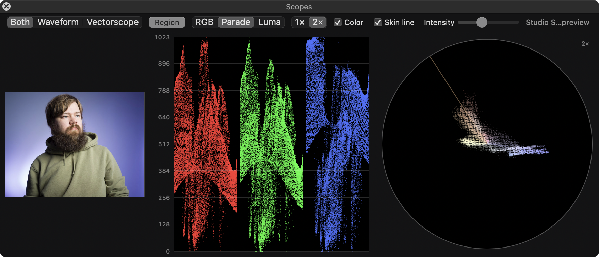

# LRC Scopes

Resolve-style **RGB waveform / parade** and **vectorscope** for the Develop module of
Adobe Lightroom Classic (macOS).

The scopes float over Lightroom in a non-activating panel (keyboard focus stays in
Lightroom, so Develop shortcuts keep working). They appear only while Lightroom is
frontmost and in Develop, and update as you edit.



## Architecture

Lightroom's SDK has no way to draw custom graphics inside the Develop module, and no
access to the live Develop render. So the plug-in has two parts:

```
Lightroom Classic                                LRC Scopes.app (bundled in the plug-in)
┌────────────────────────────────┐              ┌────────────────────────────────────────┐
│ LRCScopes.lrplugin (Lua)       │   LrSocket   │ PluginConnection (TCP client, reconnect)│
│  ScopesService                 │  127.0.0.1   │ FrameProcessor   (decode → analyse →    │
│   • target photo / module      │ ───────────▶ │                   render, latest-wins)  │
│   • adjustment observer +      │ JSON lines:  │ ScopesCore       (pure scope math,      │
│     editCount poll             │ hello, state,│                   unit tested)          │
│   • requestJpegThumbnail       │ frame(base64)│ ScopesPanel      (AppKit HUD panel)     │
│   • rate limiting, settling    │ quit         │                                         │
│  HelperLink (send-mode socket) │              │                                         │
└────────────────────────────────┘              └────────────────────────────────────────┘
```

* **Image source.** `LrPhoto:requestJpegThumbnail` returns Lightroom's own rendering of
  the photo with the current develop settings, colour managed by the helper (embedded
  ICC honoured) into sRGB. Requests are rate limited (~8/s, one in flight) while you
  drag sliders, then re-issued a few times after the last change because Lightroom
  refines its previews shortly after an edit. Identical renderings are not re-sent.
* **Change detection.** `LrDevelopController.addAdjustmentChangeObserver` for slider
  changes, plus a poll of `editCount`/`lastEditTime` for edits the observer misses
  (profile changes, masks, sync, undo, presets).
* **IPC.** Lightroom's own `LrSocket`, in "send" mode on 127.0.0.1 at a
  system-chosen port. The plug-in launches the helper with `--port <n>` and the helper
  connects as a TCP client. Messages are one JSON object per line (`hello`, `state`,
  `frame` with the JPEG in base64, `previewError`, `quit`; see `Protocol.lua` and
  `WireProtocol.swift`). The plug-in sends `state` every second so the helper can tell
  a hung Lightroom from a quiet one; the helper retries a dropped connection for 20 s,
  then exits. Nothing touches the disk.
* **Helper lifetime.** In LrC 15.6, calling `reconnect()` on an LrSocket whose client
  has gone away deadlocks Lightroom's main thread (send and receive mode alike). So
  the helper runs for the whole Lightroom session: its panel has no close button, only
  Show / Hide Scopes in Lightroom. If the helper dies anyway (crash, force quit),
  Show Scopes notices by checking for its process (a send socket doesn't report its
  client leaving), abandons that socket untouched, binds a fresh one and relaunches
  the helper. The check is deliberately not periodic: running a shell command every
  few seconds coincided with Lightroom failing preview requests after edits.
* **Scopes.** Computed from gamma-encoded R′G′B′ (as broadcast scopes and Resolve do).
  Waveform: 10-bit (0–1023) graticule, RGB overlay / parade / luma (Rec.709 Y′).
  Vectorscope: Rec.709 Cb/Cr, 75% target boxes, 100% target marks, skin tone line,
  1×/2× magnification, optional hue colourisation.

### Accuracy notes

* The scopes analyse Lightroom's preview rendering (8-bit sRGB JPEG), not the
  full-resolution raw pipeline. Levels and hues are faithful; single-pixel detail is
  not. The plug-in asks for 1024 px, but Lightroom may return a smaller preview than
  requested (≈770 px has been observed), despite the SDK documenting sizes as minimums.
* 8-bit samples are spread over their ±½-step quantisation interval with a fixed,
  repeatable dither. Without it, a 1024-level waveform of 8-bit data shows a comb of
  empty levels. No sample moves by more than one source step.
* Output is display-referred sRGB. Values outside sRGB (e.g. from a wide-gamut source)
  are clipped, just like an sRGB export.
* While dragging a slider, Lightroom renders previews asynchronously, so the scopes can
  trail the image by a fraction of a second.

## Build, test, install

Requirements: macOS 12+, Xcode 15+ (Swift 5.9+), and `lua` for the plug-in tests.

```bash
make test       # Swift unit tests + Lua state-machine tests (stubbed SDK)
make build      # → build/LRCScopes.lrplugin (universal helper, ad-hoc signed)
make install    # copies into ~/Library/Application Support/Adobe/Lightroom/Modules
```

Then restart Lightroom Classic (or add `build/LRCScopes.lrplugin` via
**File › Plug-in Manager › Add**).

For distribution, sign with a Developer ID and notarize:

```bash
SIGN_IDENTITY="Developer ID Application: Your Name (TEAMID)" scripts/build.sh
```

## Use

* **File › Plug-in Extras › Show Scopes / Hide Scopes.** The choice is remembered across
  launches. The panel has no close button; these menu items are how it is shown and hidden.
* To bind a key: System Settings › Keyboard › Keyboard Shortcuts › App Shortcuts, add
  Adobe Lightroom Classic with the menu title `Show Scopes`.
* **Region:** press *Region* to show a thumbnail of the photo, then drag on it to
  measure only that area (the scopes show a REGION badge). Click on the image outside
  the selection (or double-click, or right-click › *Measure Whole Image*) to go back.
  Clicks inside the selection or in the margin around the image change nothing. The region resets when you move
  to another photo and when you hide the thumbnail. Lightroom's own zoom can't be
  followed: the SDK can change the zoom but cannot read it or the visible area.
* Plug-in Manager options: analysis resolution, debug logging.
* Logs: `~/Library/Logs/Adobe/Lightroom/LrClassicLogs/LRCScopes.log` (plug-in) and
  `/usr/bin/log stream --predicate 'subsystem == "com.lrcscopes.helper"'` (helper).

## Layout

```
plugin/LRCScopes.lrplugin/   Lua plug-in sources
plugin/tests/run_tests.lua   offline tests against a stubbed Lightroom SDK
helper/                      Swift package: ScopesCore (library), LRCScopes (app), tests
scripts/                     build / install
```
